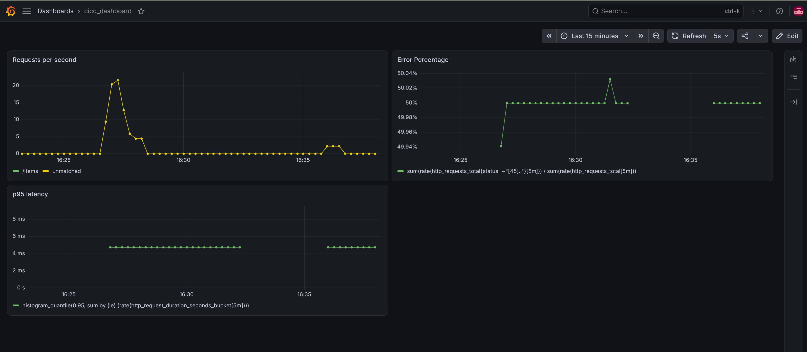

# CI/CD Monitoring Dashboard

A self-hosted CI/CD and observability project: a small Flask microservice app that is built, tested, and deployed automatically to Kubernetes on AWS, with the whole environment created from code and monitored through live Grafana dashboards.

> **Status:** In progress (Day 1). The roadmap below shows what is done and what is next.

## What this project does

The goal is to show the full path from a `git push` to a monitored production-style deployment:

1. Code is pushed to GitHub.
2. A Jenkins pipeline tests the code, builds Docker images, and pushes them to a registry.
3. Terraform provisions the AWS infrastructure the app runs on.
4. The pipeline deploys the new image to a Kubernetes cluster.
5. Prometheus scrapes metrics from every service, and Grafana turns them into dashboards showing app health and pipeline health.

Each stage depends on the one before it, so the project exercises the whole toolchain end to end instead of treating each tool in isolation.

## Architecture

```
Git push -> Jenkins -> Docker image -> Registry
                                          |
Terraform -> AWS (VPC, cluster) -> Kubernetes <-- deploy
                                          |
                          Flask services expose /metrics
                                          |
                               Prometheus -> Grafana
```

The container image tag (for example `api:abc123`) is the handoff between the build half and the run half: the pipeline builds and pushes it, then tells Kubernetes to run exactly that tag.

## Tech stack

| Layer | Tool |
|---|---|
| Application | Python, Flask |
| Containers | Docker |
| CI/CD | Jenkins |
| Infrastructure as Code | Terraform |
| Cloud | AWS |
| Orchestration | Kubernetes |
| Monitoring | Prometheus, Grafana |

## Services

| Service | Endpoints | Purpose |
|---|---|---|
| `api` | `GET /items`, `POST /items`, `GET /health`, `GET /metrics` | Simple item store. Exists to generate real traffic and metrics. |

- `/health` returns 200 OK and is used for Kubernetes health checks.
- `/metrics` exposes request count and latency in Prometheus format via `prometheus_client`.

## Repository structure

```
cicd-dashboard/
  services/
    api/
      app.py
      requirements.txt
  README.md
```

More folders (`terraform/`, `k8s/`, `monitoring/`, `Jenkinsfile`) will be added as each stage is built.

## Run locally

```bash
cd services/api
python -m venv .venv
source .venv/bin/activate
pip install -r requirements.txt
python app.py
```

In another terminal:

```bash
curl http://localhost:5000/health
curl -X POST http://localhost:5000/items -H "Content-Type: application/json" -d '{"name": "test"}'
curl http://localhost:5000/items
curl http://localhost:5000/metrics
```

## Roadmap

- [ ] Flask `api` service with `/health` and `/metrics`
- [ ] Dockerfile and local container run
- [ ] Second Flask service
- [ ] Jenkins pipeline: test, build, push image
- [ ] Terraform: AWS networking and Kubernetes cluster
- [ ] Kubernetes manifests and automated deploy from the pipeline
- [ ] Prometheus scraping the services
- [ ] Grafana dashboards for app and pipeline health
- [ ] Architecture diagram and dashboard screenshots
- [ ] Stretch: Helm chart, ArgoCD, OpenTelemetry

## Screenshots

_Coming soon: pipeline run and Grafana dashboard._

## What I learned



## Author

Kshitiz (Aadi) Bisht